# Siloscope

A monitoring and statistics dashboard for **Silo** and **Plex** in one place: live streams, server health, full playback history and Tautulli-style stats per user, with Silo and Plex accounts linked to the same person. Built mobile-first, it runs comfortably on a phone.

> Siloscope started as a fork of [safetyp1/siloscope](https://github.com/safetyp1/siloscope) and has since grown a history database, a stats section, account linking and themes. Thanks to the original author for the foundation.

<p>
  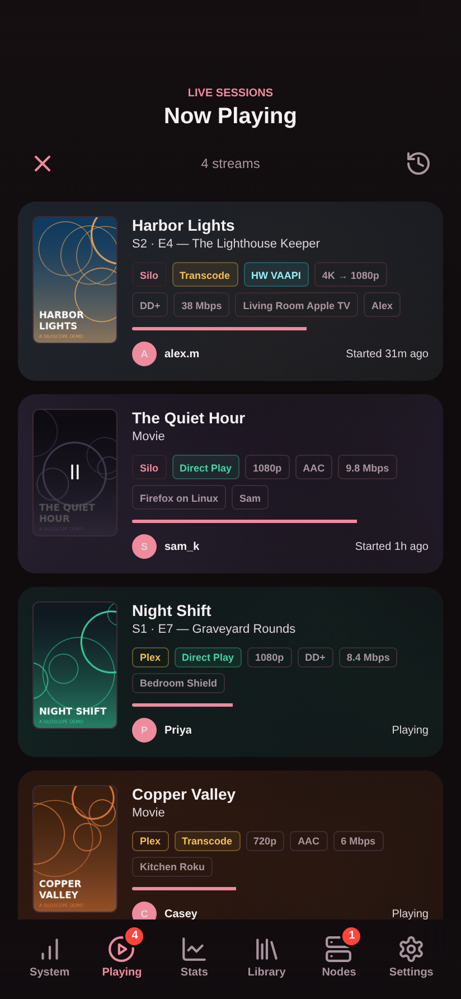
  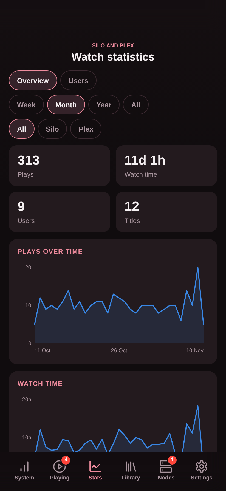
  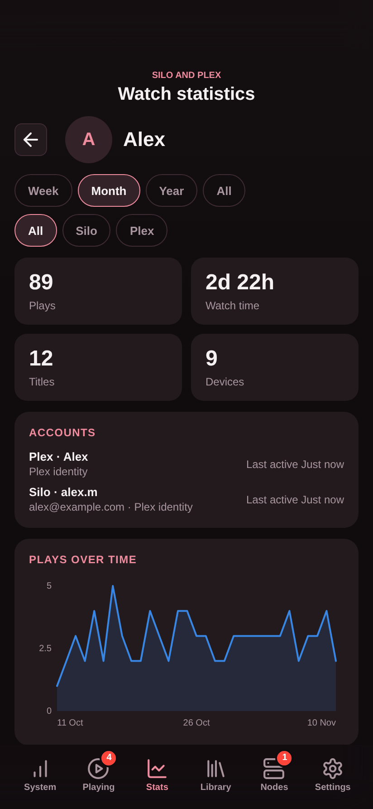
</p>

## Features

| | |
| --- | --- |
| **Now Playing** | Silo and Plex streams together: poster, user, client, quality, direct play or transcode (including hardware), bitrate and progress. Terminate one or several streams. |
| **History** | Every play from both servers, kept indefinitely in SQLite: measured watch and pause time, progress, client, platform, quality, LAN/WAN and IP. Imports Silo's full history and Plex's watch history on first start. |
| **Stats** | Plays and watch time over time, concurrent streams and the peak, plays by weekday and hour, stream quality, top platforms, most watched and most popular movies and shows, most active users, for a week, month, year or all time. |
| **Users** | Everyone who watches, on either server, with a page per person: their accounts, charts, top titles, devices and IP addresses. |
| **Linked accounts** | Silo and Plex accounts of the same person are matched automatically (by Plex sign-in or email) and can be linked, unlinked or renamed by hand, so one person is one row in the stats. |
| **Server health** | CPU, memory, bandwidth and top processes on the Silo host; disk free space with the size of each Silo library; Silo remote stream nodes. |
| **Themes** | Rose, Midnight, Light, High contrast, Console, Matrix and Synthwave, any accent colour, and per-device layout: reorder or hide tabs and panels. |
| **Sign-in** | Sign in with your Silo administrator account, including Silo's two-step sign-in. Other Silo accounts are refused. |
| **Optional extras** | Push alerts, InfiniDysk throughput, Sonarr/Radarr file replacement and Silo transcoder settings. |

## Screenshots

All screenshots use a demo server with made-up users and titles.

| System | Bandwidth and memory | Now Playing |
| --- | --- | --- |
| 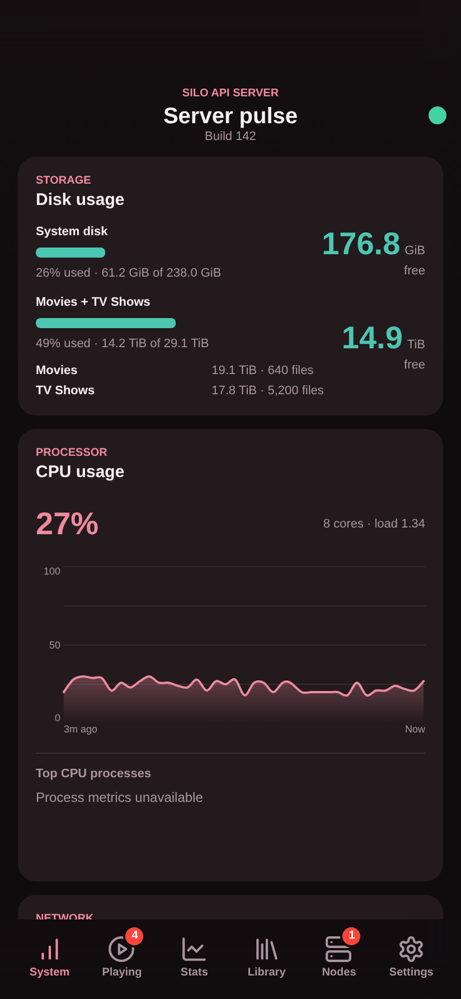 | 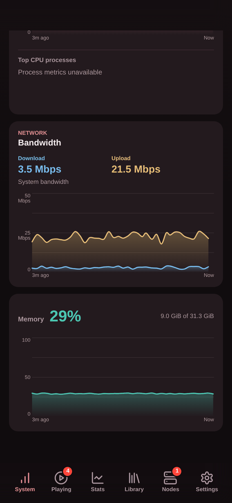 |  |

| History | Stats | Charts |
| --- | --- | --- |
| 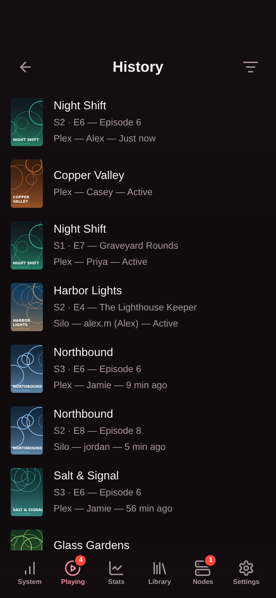 |  | 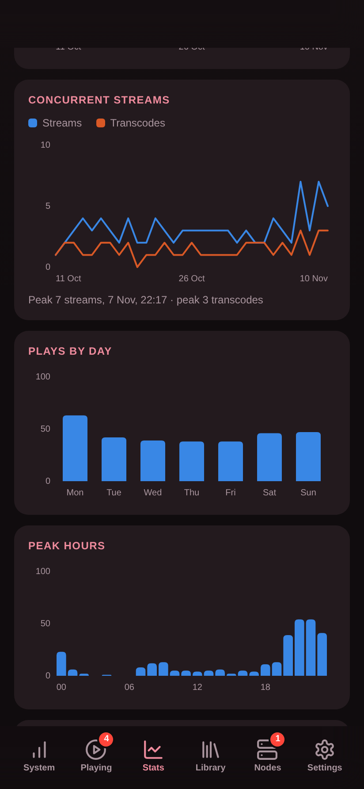 |

| Top titles | Users | A person |
| --- | --- | --- |
| 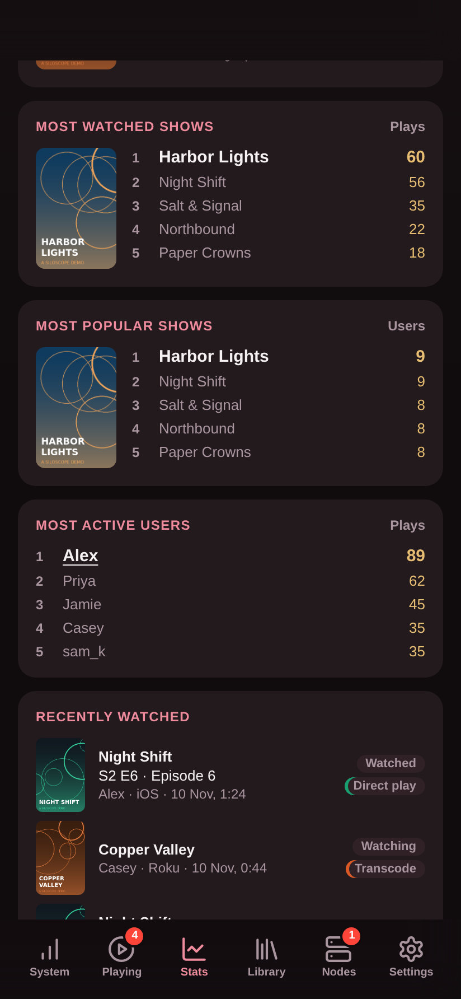 | 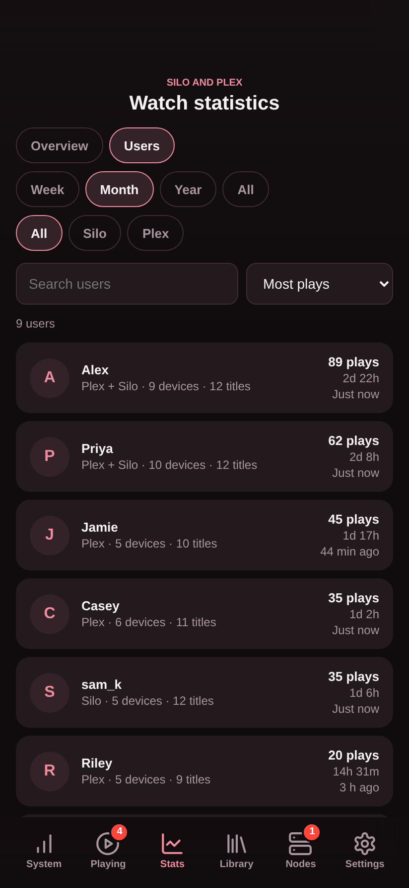 |  |

| Stream nodes | Appearance |
| --- | --- |
| 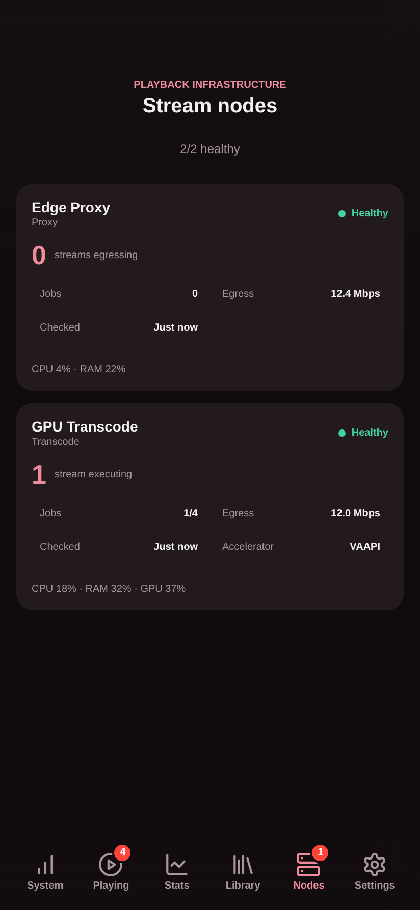 | 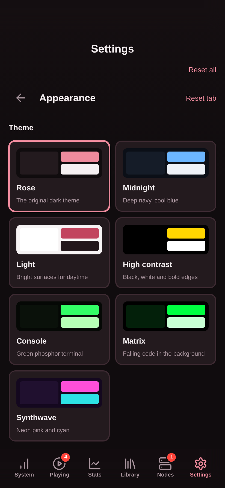 |

**Themes**

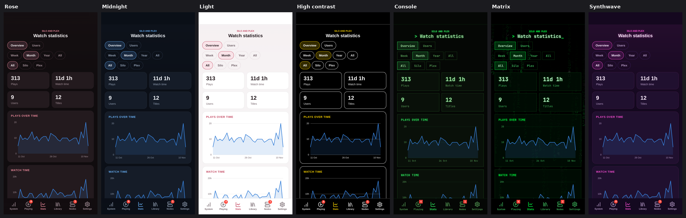

## Compatible with

| Silo | Plex |
| --- | --- |
| <a href="https://github.com/Silo-Server/silo-server"></a> | <a href="https://www.plex.tv/"></a> |
| Required: health, playback, history, nodes and transcoder settings | Optional: playback, history and stats |

Logos identify compatible services; no affiliation or endorsement is implied. See [logo sources](docs/images/LOGOS.md).

## Requirements

- Silo with the **v2 administrator API**. Older v1-only servers are not supported.
- A Silo API key with **Full access**, owned by an enabled administrator.
- Optional, recommended: a second Silo key with only the **`admin:monitor:read`** scope, for live session events (see [Silo API keys](#silo-api-keys)).
- Optional: a Plex server-owner token, and outbound HTTPS to plex.tv for account linking.
- Docker on AMD64 or ARM64, or any Linux machine for the release binary.

**Sign-in uses your Silo administrator account** (see [Sign-in](#sign-in)). Anyone signed in can stop streams, change Silo settings, restart Silo, and delete media files when replacements are enabled. Serve it over HTTPS if it is reachable from outside your network.

## Install

### Docker, next to Silo (recommended)

Run Siloscope on the machine that runs Silo. It can then reach Silo over Silo's own Docker network, and its CPU, process and bandwidth panels measure the Silo host itself.

1. Clone the repository on the Silo host and create the environment file:

   ```sh
   git clone https://github.com/neilmc78/siloscope /opt/siloscope && cd /opt/siloscope
   cp .env.example .env && chmod 600 .env
   ```

2. Find Silo's container, its network and the host's network interface:

   ```sh
   docker ps --format '{.Names}  {.Networks}  {.Ports}'
   ip route show default
   ```

3. Edit `.env`:

   | Setting | Value |
   | --- | --- |
   | `SILO_URL` | Silo's container name and **internal** port, for example `http://silo-silo-1:8080` |
   | `SILO_API_KEY` / `SILO_MONITOR_API_KEY` | Your two Silo keys |
   | `PLEX_URL` / `PLEX_TOKEN` | For example `http://192.168.1.50:32400` and your server-owner token |
   | `HOST_NETWORK_INTERFACE` | The name after `dev`, for example `eth0` |
   | `MONITOR_BIND` / `MONITOR_PORT` | `0.0.0.0` (or the host's LAN or Tailscale IP) and a free port, to open it from other devices |

4. Attach Siloscope to Silo's network: create `compose.override.yaml` with the network name from step 2:

   ```yaml
   services:
     silo-monitor:
       networks: [silo]
   networks:
     silo:
       external: true
       name: silo_default
   ```

5. Start it with host bandwidth and process monitoring:

   ```sh
   docker compose -f compose.yaml -f compose.override.yaml -f compose.host-network.yaml -f compose.host-processes.yaml up -d
   docker compose logs --tail 50
   ```

Rerun the same `up -d` after editing `.env`; a restart alone does not reload it. To update, `pull`, then `up -d` with the same files. If a pull is refused, make the `silo-monitor` package public on GitHub or `docker login ghcr.io`.

### Portainer

Set `SILO_URL`, `SILO_API_KEY`, and `HOST_NETWORK_INTERFACE` in your stack's environment variables. Add optional integrations as needed.

<details>
<summary>Complete Portainer stack</summary>

```yaml
services:
   silo-monitor:
      image: ghcr.io/neilmc78/silo-monitor:latest
      pull_policy: always
      restart: unless-stopped
      environment:
         SILO_URL: ${SILO_URL:?Set SILO_URL}
         SILO_API_KEY: ${SILO_API_KEY:?Set SILO_API_KEY}
         SILO_MONITOR_API_KEY: ${SILO_MONITOR_API_KEY:-}
         AUTH_MODE: ${AUTH_MODE:-silo}
         PLEX_URL: ${PLEX_URL:-}
         PLEX_TOKEN: ${PLEX_TOKEN:-}
         IFD_URL: ${IFD_URL:-}
         IFD_API_KEY: ${IFD_API_KEY:-}
         SONARR_URL: ${SONARR_URL:-}
         SONARR_API_KEY: ${SONARR_API_KEY:-}
         RADARR_URL: ${RADARR_URL:-}
         RADARR_API_KEY: ${RADARR_API_KEY:-}
         ARR_REPLACEMENTS_ENABLED: ${ARR_REPLACEMENTS_ENABLED:-false}
         REPLACEMENT_DATA_DIR: /data/replacements
         PUSH_CONTACT: ${PUSH_CONTACT:-}
         PUSH_DATA_DIR: /data/push
         ACTIVITY_DATA_DIR: /data/activity
         HOST_PROC_DIR: /host/proc
         HOST_NETWORK_STATS_DIR: /host/network
         LISTEN_ADDR: :8080
         GOMAXPROCS: "1"
         GOMEMLIMIT: 32MiB
      volumes:
         - notification-data:/data
         - /proc:/host/proc:ro
         - /sys/class/net/${HOST_NETWORK_INTERFACE:?Set HOST_NETWORK_INTERFACE}/statistics:/host/network:ro
      ports:
         - "${MONITOR_BIND:-127.0.0.1}:${MONITOR_PORT:-8091}:8080"
      read_only: true
      tmpfs:
         - /tmp:size=1m,mode=1777
      cap_drop:
         - ALL
      security_opt:
         - no-new-privileges:true
      pids_limit: 32
      mem_limit: 48m
      cpus: 0.10

volumes:
   notification-data:
```

</details>

Deploy the stack. Apply later configuration changes with **Update the stack**.

#### Preserve existing data

Keep `/data` writable and persistent to retain history, notifications, and replacement records. Back it up securely. **Do not delete the volume or run `docker compose down -v` during updates.**

When moving or renaming a stack, reuse its existing volume. For example:

```yaml
volumes:
   notification-data:
      external: true
      name: silo-performance_notification-data
```

Replace the example name with your actual volume name and keep the service mount as `notification-data:/data`.

### Without Docker

Each version tag (`v*`) publishes static Linux binaries for AMD64 and ARM64 on the Releases page, with a systemd unit and an example configuration. Any Linux machine or container that can reach Silo works, including a small LXC container.

```sh
VERSION=v0.1.0   # a tag from the Releases page
ARCH=amd64       # or arm64
BASE=https://github.com/neilmc78/siloscope/releases/download/$VERSION

useradd --system --no-create-home --shell /usr/sbin/nologin siloscope
wget -O /usr/local/bin/siloscope "$BASE/siloscope-linux-$ARCH" && chmod 755 /usr/local/bin/siloscope
wget -O /etc/systemd/system/siloscope.service "$BASE/siloscope.service"
install -d -m 700 /etc/siloscope
wget -O /etc/siloscope/siloscope.env "$BASE/siloscope.env.example" && chmod 600 /etc/siloscope/siloscope.env
```

Edit `/etc/siloscope/siloscope.env`, then `systemctl daemon-reload && systemctl enable --now siloscope`. Data is kept in `/var/lib/siloscope`. On a different machine from Silo, CPU, memory, disk and bandwidth come from Silo's own statistics and the top-processes panel is unavailable.

## Sign-in

Siloscope asks you to sign in with a **Silo administrator** account. It sends the username and password to Silo's own sign-in, and for accounts with two-step sign-in, the authenticator or recovery code as well. Any account that isn't an administrator is refused. Siloscope then signs straight back out of Silo, keeps no password and no Silo session, and gives the browser its own session cookie for 30 days.

- Every 15 minutes Siloscope checks with Silo that each signed-in account still exists, is enabled and is still an administrator, and signs out any that isn't.
- Sign-in attempts are limited to 10 per 10 minutes per address, on top of Silo's own limits.
- Requests that change anything are refused when they come from another website.
- **Settings** shows who is signed in, with a **Sign out** button.
- Plex sign-in and passkeys aren't supported here: sign in with the account's Silo password. An account that uses passkeys can add an authenticator app in Silo.

If an authenticating reverse proxy already guards Siloscope, set `AUTH_MODE=none` to turn sign-in off.

## Silo API keys

Siloscope uses two keys:

| Key | Access | Used for |
| --- | --- | --- |
| `SILO_API_KEY` | **Full access** | Everything that reads or changes Silo: health, sessions, history, users, libraries, transcoder settings, restarts and stopping streams |
| `SILO_MONITOR_API_KEY` | **Selected scopes → `admin:monitor:read`** only | The live session events socket, which Silo only opens for this scope |

Create both under **Admin → API Keys → Create Key** in Silo. Builds without the scope choice on that page can create the monitoring key with the full key instead:

```sh
curl -sS -X POST "$SILO_URL/api/v2/admin/api-keys" \
  -H "Authorization: Bearer $SILO_API_KEY" \
  -H "Content-Type: application/json" \
  -d '{"label":"Siloscope monitor","scopes":["admin:monitor:read"]}'
```

Without the monitoring key, live Silo plays are picked up by a 15-second poll instead.

## Configuration

| Variable | Default | Purpose |
| --- | --- | --- |
| `SILO_URL` | required | Silo base URL reachable by the monitor container |
| `SILO_API_KEY` | required | Silo admin API key |
| `SILO_MONITOR_API_KEY` | unset | Optional second Silo admin key with only the `admin:monitor:read` scope. Enables live session events for history; without it Siloscope polls Silo's session list every 15 seconds |
| `PLEX_URL` | unset | Optional Plex Media Server base URL, usually `http://plex:32400` |
| `PLEX_TOKEN` | unset | Plex server-owner token; required with `PLEX_URL` ([find your token](https://support.plex.tv/articles/204059436-finding-an-authentication-token-x-plex-token/)) |
| `IFD_URL` | unset | Optional InfiniDysk backend URL, for example `http://nzbdav:8080` on a shared private Docker network |
| `IFD_API_KEY` | unset | Same value as InfiniDysk's `FRONTEND_BACKEND_API_KEY`; required with `IFD_URL`, kept server-side |
| `SONARR_URL` / `SONARR_API_KEY` | unset | TV library integration; configure together, usually `http://sonarr:8989` |
| `RADARR_URL` / `RADARR_API_KEY` | unset | Movie library integration; configure together, usually `http://radarr:7878` |
| `ARR_REPLACEMENTS_ENABLED` | `false` | Explicit opt-in to destructive Library actions; requires administrator-only proxy access |
| `REPLACEMENT_DATA_DIR` | `/data/replacements` in Docker/Compose | Persistent replacement records; required when replacements are enabled |
| `AUTH_MODE` | `silo` | `silo` requires signing in with a Silo administrator account; `none` turns sign-in off for use behind an authenticating proxy |
| `LISTEN_ADDR` | `:8080` | Address used by the Go server |
| `MONITOR_BIND` | `127.0.0.1` | Host address published by Compose |
| `MONITOR_PORT` | `8091` | Host port published by Compose |
| `HOST_NETWORK_INTERFACE` | `eth0` | Host NIC used by the optional bandwidth override |
| `HOST_NETWORK_STATS_DIR` | unset | Host network statistics path; supplied by the network override |
| `HOST_PROC_DIR` | unset | Host process statistics path; supplied by the process override |
| `PUSH_CONTACT` | unset | Enables Web Push when set to a real `mailto:` address or HTTPS contact URL |
| `PUSH_DATA_DIR` | `/data/push` in Compose | Persistent notification data; required when push is enabled |
| `ACTIVITY_DATA_DIR` | `/data/activity` in Docker/Compose | Playback history database (`siloscope.db`); set explicitly for standalone binaries |

The image is published for AMD64 and ARM64 at `ghcr.io/neilmc78/silo-monitor:latest`; release binaries are attached to each `v*` tag.

## How it works

### Playback history

History is stored in SQLite at `ACTIVITY_DATA_DIR/siloscope.db` and kept indefinitely. Back up the data volume to keep it.

| Source | How plays are recorded |
| --- | --- |
| Silo | Silo's own finalized playback log is the authority for ended plays, with measured watch and pause time, client, device, IP and stream decisions. On first start Siloscope imports all of it. Live plays follow Silo's session events (with `SILO_MONITOR_API_KEY`) or a 15-second poll. |
| Plex | Siloscope listens on Plex's notification websocket. Each play records the source file (codec, resolution, HDR, bitrate) and the stream (decisions, hardware transcoding, subtitle burn-in, bandwidth, LAN/WAN). Watch and pause time are measured from Plex's position updates; seeks are not counted. A play counts as watched at 85%. On first start, Plex's own watch history is imported for earlier views; Plex keeps only finished views, so those rows have no duration or stream details. |

Silo posters are cached in the data directory the first time they are seen, so history keeps its artwork after Silo's signed image links expire.

### Stats

Stats cover a week, month, year or all time, for Silo, Plex or both. A resumed play counts once, and unfinished attempts under 30 seconds are ignored, as in Tautulli. A show watched on both servers is one title. Concurrent streams are worked out from play start and end times, so imported history counts too. Weekday and hour use the viewing device's time zone.

### Linked accounts

Every Silo and Plex account belongs to a person. Siloscope links a Silo account and a Plex account to the same person automatically when either:

1. the Silo account was signed in through the [Plex sign-in plugin](https://github.com/neilmc78/silo-plugin-auth-plex) and carries the same plex.tv account ID, or
2. both accounts have the same email address, ignoring case, unless they carry different plex.tv IDs.

Plex account names come from the Plex server; plex.tv supplies the IDs and emails, so allow outbound HTTPS to plex.tv. Silo doesn't verify the emails people enter, so check new matches on the Users page.

To fix a match by hand, open a person in **Stats → Users**. **Link another account** moves any other account to this person, **Unlink** splits an account off into its own person, and **Rename** changes the name shown. Automatic matching never undoes a manual change. The same actions are available through `POST /api/people` (`{"action":"link","account_ids":[1,2]}`, `{"action":"unlink","account_id":1}`, `{"action":"rename","person_id":1,"display_name":"Sam"}`), and `GET /api/people` lists people and their accounts.

### Disk usage and library sizes

Silo reports disk usage per mount. Library folders on one shared mount, such as a NAS share, are shown once and named after their Silo libraries. Each library's size and file count are totalled from Silo's catalog every six hours, without scanning the share.

### Stream nodes

The **Nodes** tab shows Silo's remote stream nodes: transcode workers that convert streams live on another machine, and proxies that relay streams to viewers. A single-server Silo has none; hide the tab under Settings → Navigation.

## Settings

- **Appearance:** theme, accent colour (presets or any colour) and animated effects: Console scanlines and cursor, Matrix code rain. Reduced-motion devices always get still versions.
- **Navigation:** reorder the bottom tabs or hide the ones you don't use. Settings always stays.
- **System, Playing, Nodes:** choose which panels and details appear, reorder System panels, and set chart height and time range.
- **Transcoder:** Silo's transcoding and 4K permissions, hardware acceleration, HDR tone mapping, buffering, throttling and playback routing.
- **Restart:** see pending restart requirements and restart Silo after confirmation.
- **Notifications:** push alerts; see below.

Display settings are saved per device.

## Optional integrations

### Push notifications

Choose the alerts you want under **Settings > Notifications**:

| Alert | Scenario |
| --- | --- |
| CPU | Sustained high usage and recovery, with configurable thresholds and cooldown |
| Disk | Usage exceeds your selected threshold |
| Playback | A new Silo or Plex session starts |
| Transcoding | A new session is transcoding at its one-time check around one minute after discovery; includes audio-only transcoding |
| Service | Silo, Plex, or an enabled node becomes unavailable or recovers |

Set `PUSH_CONTACT`, open Siloscope over HTTPS, and enable notifications on each device. On iOS 16.4 or later, first add Siloscope to the Home Screen and open it there. Titles and usernames are optional notification details.

Alerts can arrive with the dashboard closed. Delivery depends on connectivity and device permissions; Siloscope cannot alert while it is down.

### InfiniDysk

InfiniDysk uses the private backend (normally port 8080), not its port 3000 browser interface. Do not publish its backend port for this integration. Generate a shared secret with `openssl rand -hex 32`, set it as `FRONTEND_BACKEND_API_KEY` in the InfiniDysk stack and as `IFD_API_KEY` in Siloscope, then recreate both services. Recreating IFD may briefly interrupt streams or downloads. Keep the existing normal IFD API key unchanged: that key supports statistics but cannot authenticate the active-file WebSocket in IFD 1.5.0.

For Dockhand or Portainer, supply the generated value through each stack's environment configuration. Both containers must share a private Docker network. In the Siloscope service, use:

```yaml
environment:
   IFD_URL: http://nzbdav:8080
   IFD_API_KEY: ${IFD_API_KEY}
```

Replace `nzbdav` with your IFD service's network name if different. In the IFD service, map `FRONTEND_BACKEND_API_KEY: ${FRONTEND_BACKEND_API_KEY}` under `environment`, supplying the same generated value. Keep secrets out of Git. Leave both Siloscope IFD variables unset to disable the integration.

Throughput is sampled every five seconds; fetched throughput uses IFD's recorded byte totals and may lag while those totals are persisted. Served throughput uses its cumulative byte counter. Per-file fetching speed is derived from live read updates; unknown values appear as `--`, not zero.

Under **Settings > System**, move the InfiniDysk panel up or down, toggle its individual elements, or change the shared graph height and time window. These preferences are saved per device. Existing saved panel orders are preserved, with InfiniDysk appended until repositioned.

### Library: find and replace media

**Library** searches titles already managed by Sonarr or Radarr; it does not add new titles. Search is available without enabling replacements.

| Search | Result |
| --- | --- |
| Movie or series title | Matching library items |
| `the simpsons s05e19` | The exact episode |
| `the simpsons s05` | Episodes from season five |

If multiple series match, choose one to continue.

Enable `ARR_REPLACEMENTS_ENABLED=true` to use **Replace**. Review the file and release, then confirm **Delete and search** to delete the file, blocklist its release, and search for a replacement. Recent operations show progress and offer **Retry search** when available.

An individually stored episode from a season pack can be replaced: only that episode's file is deleted, the whole pack release is blocklisted, and a replacement search is requested for that episode.

**Replacement can interrupt playback and does not guarantee a new or better file.** Files containing multiple episodes and files without identifiable download history must be handled directly in Arr. If an operation is uncertain, check Arr before retrying; do not clear replacement records to bypass the warning.

### Terminate playback

Select one or more Silo or Plex sessions in **Playing**, then choose **Terminate**. This acts immediately without a confirmation dialog.
